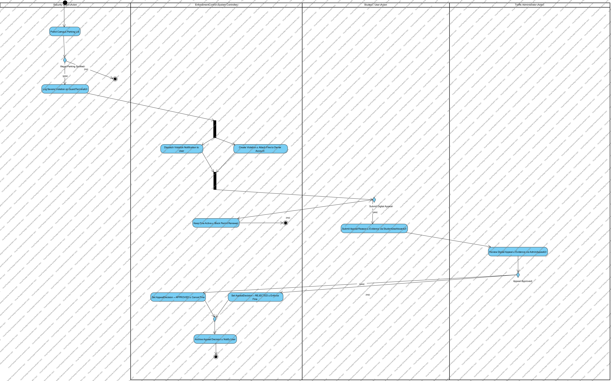
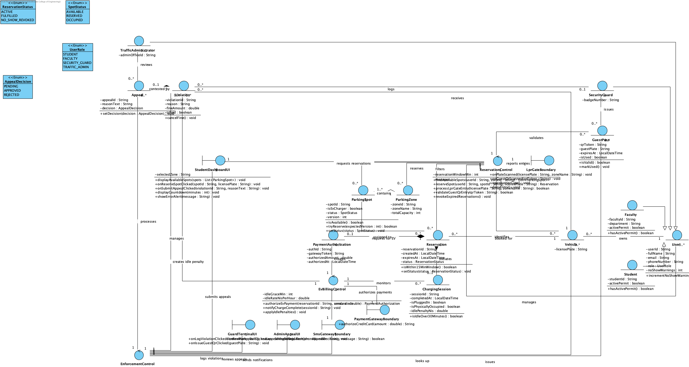
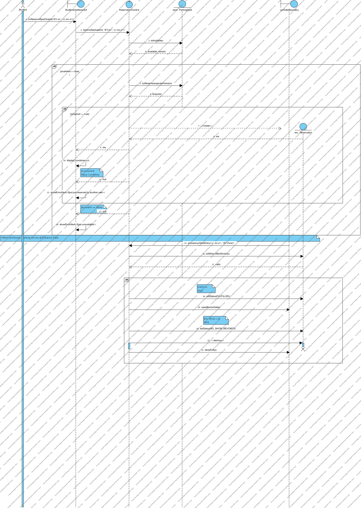
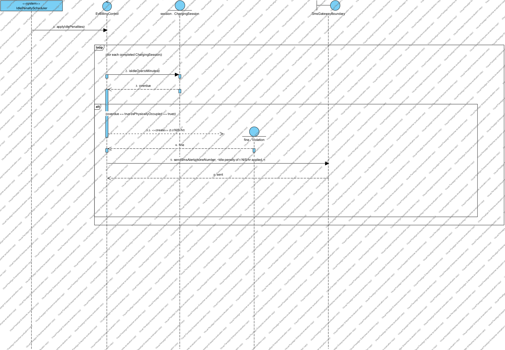

# System Architecture & Object-Oriented Design (`Ex4_SmartParking_Design`)

**Course:** 61756 Software Engineering Methods (Academic Year 2026-2027)
**Institution:** ORT Braude College of Engineering | Department of Software Engineering
**Domain:** Smart Campus Parking, LPR, and EV Network (Continued from Exercise 1)

---

## 1. Engineering Team Details

| Role                   | Full Name | Braude Academic Email |
| :---                   | :---                    | :---                             |
| **Student A (Role A)** | `Guy Gabi Kikozashvili` | `Guy.Kikozashvil@e.braude.ac.il` |
| **Student B (Role B)** | `Lior Shor`             | `Lior.Shor@e.braude.ac.il`| 

* **Group Number:** `G13`
* **GitHub Repository URL:** `https://github.com/liorshor27/Ex4_SmartParking_Design`

---

## 2. Step 1: Business Process Modeling — Activity Diagram (`Visual Paradigm`)

* **PlantUML Source:** [`diagrams/activity_appeal.puml`](diagrams/activity_appeal.puml)
* **Visual Paradigm Model:** [`SystemModel_Ex4.vpp`](SystemModel_Ex4.vpp)
* **Partitions / Swimlanes:** Separates external **Actors** (`Security Guard`, `Student / User`, `Traffic Administrator`) from the internal **System Controller** (`EnforcementControl`), using `initial node`, `fork`/`join` (AND), `decision` (XOR) with explicit `[guards]`, `merge` (OR), and `activity final node`.



---

## 3. Step 2: Structural Modeling — ECB Class Diagram (`PlantUML` -> `Visual Paradigm`)

Following the **ECB (Entity-Control-Boundary)** architectural pattern:

| ECB Stereotype | Classes in System | Architectural Responsibility |
| :--- | :--- | :--- |
| **`<<boundary>>`** | `StudentDashboardUI`, `GuardTerminalUI`, `AdminAppealUI`, `LprGateBoundary`, `PaymentGatewayBoundary`, `SmsGatewayBoundary` | Interfaces with external Actors and external hardware/payment/SMS systems. Communicates ONLY with `<<control>>` classes. |
| **`<<control>>`** | `ReservationControl`, `EvBillingControl`, `EnforcementControl` | Multiple specialized controllers orchestrating business rules, timers, concurrency checks, and workflows. |
| **`<<entity>>`** | `User` (`Student`, `Faculty`, `SecurityGuard`, `TrafficAdministrator`), `GuestPass`, `Vehicle`, `ParkingZone`, `ParkingSpot`, `Reservation`, `PaymentAuthorization`, `ChargingSession`, `Violation`, `Appeal` + 4 UML `enum`s | Passive domain data classes storing persistent business state and domain helper methods. |

* **PlantUML Source:** [`diagrams/class_diagram_ecb.puml`](diagrams/class_diagram_ecb.puml)
* **Visual Paradigm Model:** [`SystemModel_Ex4.vpp`](SystemModel_Ex4.vpp)



---

## 4. Step 3: Behavioral Modeling — ECB Sequence Diagrams (`PlantUML` -> `Visual Paradigm`)

### 4.1 Sequence Diagram 1: Spot Reservation, LPR Gate Entry & No-Show Destruction
* **PlantUML Source:** [`diagrams/sequence_reservation_ecb.puml`](diagrams/sequence_reservation_ecb.puml)



### 4.2 Sequence Diagram 2: EV Charging 30-Minute Idle Penalty (`loop` & `<<create>>`)
* **PlantUML Source:** [`diagrams/sequence_idle_penalty_ecb.puml`](diagrams/sequence_idle_penalty_ecb.puml)



---

## 5. Independent AI Prompt & Architectural Design Critique (Part 4)

Attached files (via `@` in Continue): `SYSTEM_STORY.md`, `diagrams/class_diagram_ecb.puml`, `diagrams/sequence_reservation_ecb.puml`.

```text
You are a senior software architect reviewing a UML design before it is frozen. Using the attached SYSTEM_STORY.md, class_diagram_ecb.puml and sequence_reservation_ecb.puml, audit our ECB design against the two edge cases in Section 3 of SYSTEM_STORY.md:
(A) Two students click "Reserve" on the last available spot in the Student Zone at the exact same millisecond.
(B) An EV driver unplugs the charging cable at minute 29 but leaves the car physically parked in the EV bay.
For each edge case: (1) state whether the current Class Diagram and Sequence Diagram handle it correctly, referencing the exact attributes and operations (e.g. version, tryReserve(expectedVersion), isPluggedIn, isPhysicallyOccupied); (2) point out any gap or inconsistency between the two diagrams; (3) suggest one concrete UML improvement (a new attribute, operation, message or alt branch). Answer in short bullet points.
```

* **Improvement 1 Applied (Race Condition):** Added `version: int` and `tryReserve(expectedVersion: int): boolean` on `ParkingSpot` (and nested `alt acquired == true/false` in Sequence Diagram 1) to prevent simultaneous double-booking.
* **Improvement 2 Applied (EV Physical Occupancy):** Separated `isPluggedIn` from `isPhysicallyOccupied` on `ChargingSession` so unplugging the cable at minute 29 without moving the car still triggers the 30-minute Charger Idle Penalty.
* **Improvement 3 Applied (AI-suggested — explicit optimistic-locking version):** The AI review noted that the Sequence Diagram did not show where `expectedVersion` comes from. We changed the reply of `isAvailable()` in Sequence Diagram 1 from `available` to `available, version`, so `ReservationControl` visibly reads the spot's current `version` and passes it to `tryReserve(expectedVersion)`. If another student reserved first, the version has changed, `tryReserve` returns `false`, and the flow enters the `[Concurrent Race Condition]` branch. No Class Diagram change was needed (`version` already exists on `ParkingSpot`).
* **AI review limitations (filtered by the team):** The local model's answer was truncated before Edge Case B, wrongly claimed `tryReserve(expectedVersion)` was missing from the Sequence Diagram, and proposed a "race" scenario with two *sequential* calls through one shared UI instance. When asked to continue with Edge Case B, it hallucinated a different edge case ("spot not visible on dashboard") with a non-existent `visibleSpots` attribute and a Boundary→Entity call. These suggestions were rejected after verification against our models. Our own check of Edge Case B: the idle-penalty guard in Sequence Diagram 2 is based on `isPhysicallyOccupied`, not `isPluggedIn`, so unplugging at minute 29 without vacating the bay still triggers the penalty — handled correctly.

---

## 6. License
Distributed under the **ORT Braude College Academic License** (61756 Software Engineering Methods, 2026-2027).
